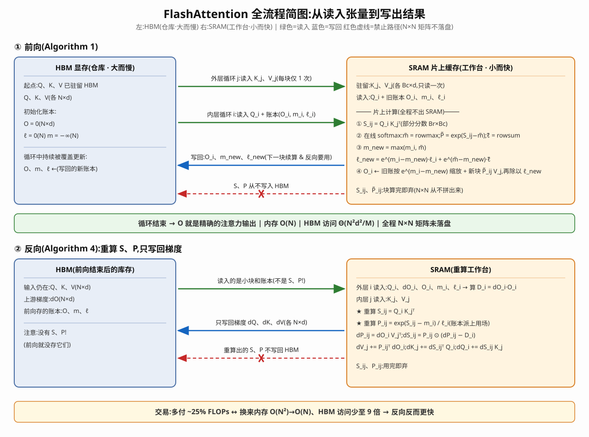

# 笔记2026/10/16

**论文：** FlashAttention: Fast and Memory-Efficient Exact Attention with IO-Awareness（Dao 等，NeurIPS 2022）

# 前言
Transformer模型已经成为自然语言处理和图像分类等应用中使用最广泛的架构。但是面临几个问题

### 问题
1、自注意力的时间和内存复杂度是序列长度的二次方，因此transformer在长序列上速度慢且内存消耗大。
2、近似注意力（Performer/Linformer等）牺牲精度降低计算量，但实际速度往往没有提升——省的是FLOPs，不是HBM搬运。

### 任务

证明Flashattention是一个通用的IO-aware 是个通用底盘

### 方案
提出了ioaware算法，目标不是减少FLOPs，而是减少HBM的读写：
1、（前向传播阶段）Tiling分块：将QKV矩阵分块，每次只将一个块送入SRAM。softmax分不了，用online softmax解决：记两个账本（行最大值m、行exp和ℓ），每算完一块就修正之前的结果，最终和完整softmax完全一致。
2、（反向传播阶段）Recomputation.重计算：避免反向传播过程中重新读取HBM，通过直接重新计算的方式（重算要比从HBM重新读取要快）。前向不存N×N的S、P，只存O、m、ℓ，反向现场重算。
3、核融合（Kernel fusion）：QK^T、softmax、mask/dropout、PV融合进一个CUDA kernel，中间结果不出SRAM。
4、效果：内存O(N²)→O(N)；HBM访问降到Θ(N²d²/M)（论文证明了下界，接近最优）；GPT-2的注意力计算最高7.6×。

流程图（前向+反向；绿=读入 蓝=写回 红虚线=禁止路径）：


## 实验：
三层递进：端到端训练 → 长上下文 → 注意力微基准。所有对比都是从零重新训练，不做近似，只换注意力实现。

分别将BERT和GPT-2进行重新训练和对比
### BERT.
协议：照搬MLPerf 1.1参考实现，训练到验证准确率72.0%就停并计时；同一初始化、同一数据切分；8张A100-80GB，跑10次取平均。

结论：
1、20.0min → 17.4min，端到端快15%。
2、不是kernel层面的局部优化，真实训练里能兑现。

### GPT-2.
注：GPT-2 small

|名字|参数量|备注|
|---|---|---|
|GPT-2 **small**|**117M**|论文用的主力|
|GPT-2 **medium**|**345M**|论文也训了（6.9–21 天那次）|
|GPT-2 large|762M|—|
|GPT-2 XL|1.5B|GPT-2 家族最大|

协议：按Megatron 配方，统一400K步，8张A100-40GB。OpenWebText。

结论：
1、最高3×（vs HuggingFace），1.7×（vs Megatron-LM）。
2、验证困惑度曲线和基线几乎重合，说明没改数值行为。
3、4K上下文仍比Megatron 1K上下文快30%，困惑度还好0.7。

### LRA（近似注意力的主场）
Long-Range Arena：长序列基准套件（ListOps/Text/Retrieval/Image/Pathfinder，1K–4K）。五个任务的加速取几何平均。

结论：
1、FlashAttention 2.4×，block-sparse版2.8×。
2、Performer只有1.8×、Reformer 1.3×，近似方法省的FLOPs换不来速度；Linformer能到2.5×但精度全场最低（54.9 vs 59.8）。
3、"FLOPs好看 ≠ 真的快"，这张表是实证。

### 那几个近似方法是什么（Performer 1.8×、Reformer 1.3× 的来历）
都是只换掉 attention 零件的 Transformer（FFN/LayerNorm 骨架不动），思想：牺牲"每个token看所有token"，省计算量。

|方法|换掉的零件|核心思路|理论复杂度|
|---|---|---|---|
|Performer|softmax注意力→FAVOR+随机特征|随机特征近似softmax核，绕开N×N矩阵|O(N)|
|Reformer|全对注意力→LSH分桶|相似的Q/K哈希进同桶，桶内互看；可逆层省内存|O(N log N)|
|Linformer|K/V→低秩投影|假设注意力矩阵低秩，直接压序列长度|O(N)|
|Local Attention|全局→滑窗局部|每个token只看邻近窗口|O(N·w)|

理论O(N)≠实际快，落地税有三笔：哈希/投影本身是额外kernel；分桶=乱序搬运，撞在HBM最疼的点上；多步流程没法融合，中间结果都要落HBM。所以FLOPs省了、wall-clock反而不如不近似的FlashAttention。

```
                拿什么换速度？
    ┌──────────────────┼──────────────────┐
    ↓                  ↓                  ↓
  流派A：换算法        流派B：换实现        流派C：换结构
  Performer/Reformer/  FlashAttention      block-sparse FA
  Linformer/Local      (exact,不近似,      (同一个底盘+块掩码)
  (近似,魔改attention)  只重写kernel)       (近似,但用IO-aware实现)
  → 省FLOPs,掉精度     → 省访存,不掉精度    → 省块搬运,2.8×
  → 实测1.3–2.5×      → 实测2.4×           → 精度基本不掉
```
近似思想本身没错，错在不考虑访存的底盘上做近似——同样稀疏思想装进IO-aware底盘就是block-sparse FA，2.8×全场最快。

### 长上下文
结论:
1、长文档分类（MIMIC-III/ECtHR），序列拉长最多提升6.4分。
2、Path-X（16K）61.4%、Path-256（64K）63.1%，首个超过随机水平的Transformer——能训这么长靠的就是内存线性省。

### 注意力微基准
协议：随机的QKV，序列长度128→65536，dropout 0.1，运行时取100次平均；基线加长到OOM为止；硬件扫A100/3090/T4。

结论：
1、注意力kernel本身最高7.6×，A100普遍2–4×，3090反而更高（带宽低）。
2、对比NVIDIA Apex FMHA相当：前向略快、反向略慢（要重算）。

## 总结
1、attention是memory-bound的，优化对象是访存不是FLOPs。
2、exact是本质优势：零精度损失，还能反超各种近似方法。
3、后来FlashAttention成了大模型时代默认注意力实现，长上下文的可行性和这篇直接相关。

## 疑问（待补）
1、反向重算多花的FLOPs原文没给数（~25%是流传说法）。
2、FlashAttention-2/3改了什么？FlashDecoding/PagedAttention是什么？
