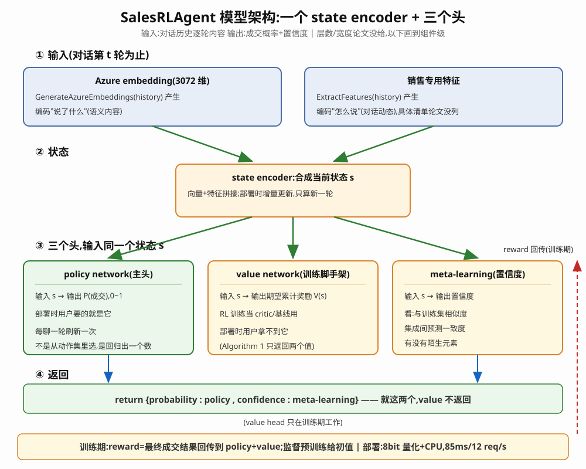
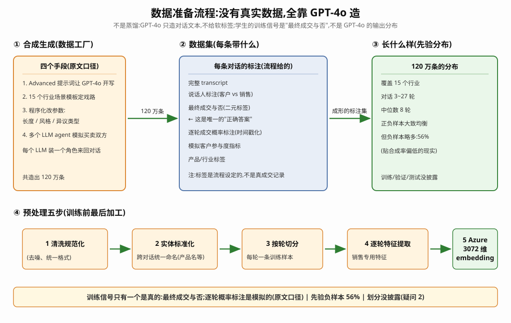
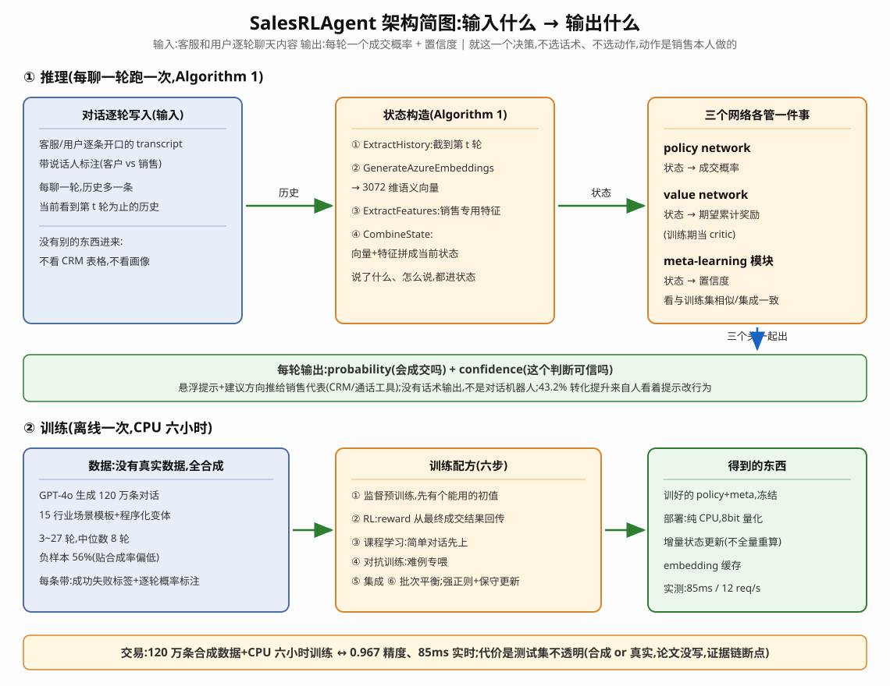

# 笔记2026/10/16（v2）

**论文：** SalesRLAgent: A Reinforcement Learning Approach for Real-Time Sales Conversion Prediction and Optimization（Nandakishor M，arXiv 预印本 2025，arXiv:2503.23303）

# 前言
销售工具里的AI现在都是LLM+RAG，能答题、会生成文本，不会算"这单还成不成"。但是面临几个问题

### 问题
1、LLM不输出成交概率，只生成内容。
2、LLM每轮独立处理，丢序列动态，看不见转折点。
3、GPT-4推理3450ms，对话进行中没法实时提示。
4、真实销售对话带敏感信息，没有公开数据集。

### 方案
输入：客服和用户逐轮聊天内容。输出：每轮一个成交概率+置信度。就这一个决策：不选话术、不选动作，对客户的动作是销售本人做的。是现状评分器不是行动模拟器：输入只有已发生的对话，不含没发的草稿，"先算你下条消息的影响再决定发不发"论文没做。
1、（状态）Azure embedding 3072维+逐轮状态跟踪+销售特征：说了什么、怎么说，都编码进状态。
2、（模型）三个网络：state encoder压缩状态；policy network出概率；value network估累计奖励；meta-learning模块出置信度，陌生模式给低置信度。RL训练：reward从最终成交结果回传，强正则、保守更新、按难度自适应学习率。

3、（数据）GPT-4o合成120万条对话，15行业，3~27轮，中位数8轮，负样本56%。

4、（训练配方）监督初始化→RL→课程学习→对抗样本→集成→批次平衡。CPU上6小时训完。
5、（部署）8bit量化+embedding缓存+增量状态更新，85ms，达标<100ms目标。
6、效果：96.7%对GPT-4 62%；85ms对3450ms。

## 实验：
四块：精度对比、推理对比、消融、真实A/B；基线不重训，直接对比

### 精度（表I）.

|方法|Accuracy|AUC-ROC|
|---|---|---|
|Random Forest|0.67|0.71|
|XGBoost|0.69|0.74|
|GPT-4（zero-shot）|0.59|0.63|
|GPT-4（few-shot）|0.62|0.68|
|Commercial System A|0.71|0.76|
|Commercial System B|0.73|0.78|
|Hybrid LLM+ML|0.75|0.81|
|SalesRLAgent（base）|0.92|0.94|
|SalesRLAgent（full）|0.967|0.98|

结论：
1、96.7%对GPT-4 few-shot 62%，高34.7个百分点。
2、比最好商业系统73%高23.7个百分点。

### 推理（表II）.

|方法|Latency（ms）|Throughput（req/s）|
|---|---|---|
|GPT-4（API）|3450|0.3|
|GPT-3.5（API）|980|1.0|
|Claude（API）|2750|0.4|
|Local LLM|1650|0.6|
|SalesRLAgent（CPU）|85|12|

结论：
1、85ms对3450ms，快约40倍。
2、12 req/s对0.3 req/s，支撑多用户并发。

### 消融（表III）.

|配置|Accuracy|
|---|---|
|Full SalesRLAgent|0.967|
|- Azure OpenAI embeddings|0.89（-0.077）|
|- Sequential modeling|0.86（-0.107）|
|- Meta-learning|0.94（-0.027）|
|- Advanced orchestration|0.92（-0.047）|
|- Caching optimization|0.95（-0.017）|
|- 全部specialization退回普通ML|0.68（-0.287）|

结论：
1、去顺序建模掉10.7pp，去embeddings掉7.7pp，这两个是主力。
2、全去掉剩0.68，精度来自specialization不是数据。

### 真实A/B.
协议：217名销售随机分组，90天，12433通对话；对照组传统工具，实验组加实时指导。
结论：
1、转化率+43.2%。
2、销售周期-22%。
3、客单价+14%。
4、满意度+9%。

## 总结
1、本质：每轮对话进、一个成交概率出；RL只是训练方式，reward是成交结果。
2、赢LLM靠三点：序列建模、专门化训练、毫秒推理。
3、回看：训练数据是GPT-4o合成的，测试集没写清，数字好看，证据链弱。

## 疑问（待补）
1、RL算法没点名，超参数没给。
2、测试集是合成还是真实？没写。
3、A/B无显著性检验，对照组基线转化率没披露。
4、商业系统匿名到没法复核。
